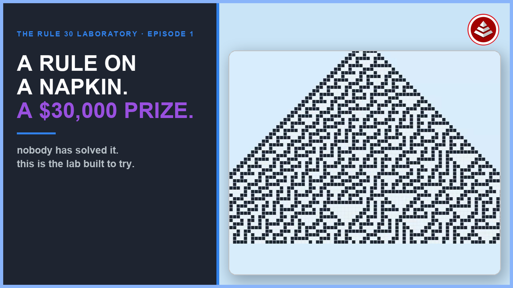
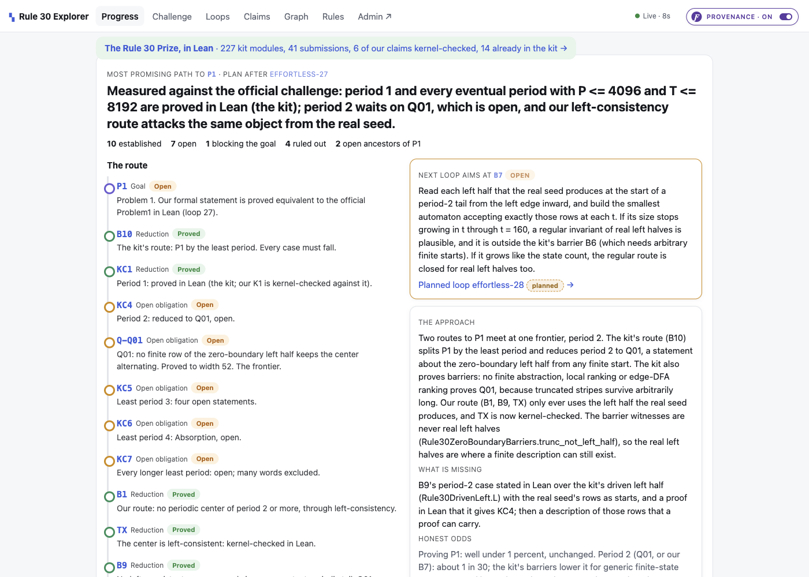

# The Rule 30 Laboratory

[](https://effortlessapi.com/watch/p1b6DwEf1HI)

**A workbench for the [Wolfram Rule 30 Prize](https://rule30prize.org/).** One rulebook holds the whole
attack on the prize's three open problems: Rule 30 itself, every research loop, every claim and what it
rests on, the organizers' Lean kit, and every public submission. You and the machine read the same page,
and every status on it is computed, not typed.

*The film above (about 15 minutes) starts from the triangle and the rule, so you need no background.*

---

## Is this for you?

**Use it if you want to:**

- work on the prize and need to see, in one place, what is proved, what is ruled out, and what is open;
- test a hypothesis about Rule 30's center column and get a verdict from the model instead of from memory;
- check a claim against the organizers' kit before calling it new;
- see how a machine-graded problem can be kept in one source of truth (the method is
  [Effortless Rulebook](https://github.com/EffortlessAPI/effortless-skills); this repo is a worked example).

**Know before you start:**

- **No prize problem is proved here.** The plan's own estimate for Problem 1 is well under 1 percent. The
  repository is set up to help whoever gets there.
- It is a research ledger, not a library. You run it, read it, and add loops to it.
- A full build takes 6 to 9 minutes and calls hosted transpilers, so it needs network access.

## What you get



| | |
|---|---|
| **The plan** | The route from Problem 1 down to the open claim that blocks it, with the next loop's aim and the odds. |
| **The prize as graded** | The official Lean statements, ours beside them, proved equivalent for P1, and the organizers' case split by period. |
| **Claims** | 315 of them. Each has a statement, a status the build computed, instances checked against the real cells, and a Lean check. |
| **A graph** | The route to P1 in about a dozen boxes, or every claim; an open claim visibly holds up what rests on it. |
| **Loops** | 27 experiments, each a hypothesis, a verdict and a build receipt you can audit. |
| **The tables** | Everything above is read from one file you can open and edit in a browser. |

## Start in ten minutes

You need `python3`, Node 18 or newer, Docker, and the `effortless` CLI
([install](https://github.com/effortlessapi/cli); it needs .NET 8).

```bash
git clone https://github.com/eejai42/rule-30-wolfram-prize.git
cd rule-30-wolfram-prize
./start.sh
```

The first launch loads the 25 MB rulebook into Postgres, which takes a couple of minutes. The explorer says
"Loading" until the API answers. Then open:

| | |
|---|---|
| http://localhost:7431 | **The explorer.** Start here. |
| http://localhost:42442 | **The rulebook editor.** Every table, row and formula. |
| http://localhost:42441/api/docs | The generated API the explorer reads. |

Lean is optional. Without it the build runs and says `lean: skipped`. To check proofs against the kit
yourself, install [elan](https://lean-lang.org/) and run `./start.sh sync`; the first run takes about an hour
and 8 GB.

## Your first half hour

1. **Read the landing page.** Find the route, the claim marked *blocking*, and the card that says where
   the next loop aims. Then read [`docs/p1-frontier.md`](docs/p1-frontier.md), the map of what has been
   tried and ruled out.
2. **Hover a number.** Keep *Provenance* on (top right), hover any count, and click the badge that appears. You get the
   rule that produced it, in plain English and as a formula.
3. **Open one claim.** `/claims/TX` shows a theorem, its 64 instances, its Lean statement and the kernel's
   verdict. This is what "decided by the build" looks like.
4. **Open the graph.** `/graph` shows the route to P1. Switch to *Every claim* for the whole ledger.
5. **Read a finished loop.** `/loops/effortless-24` and its script,
   [`research/loop-24-kill-bound/run.py`](research/loop-24-kill-bound/run.py): a hypothesis stated as
   rows, refuted by the build, with nothing computed by hand.

## Your first experiment

Loop 24 is the template. It states one hypothesis as a formal statement plus one row per case, then calls
`run_loop`, which builds and lets the model decide.

1. Pick an open obligation from the frontier map. Check `Assertions.IsKnownInKit` first: a claim the kit
   already proves is not new.
2. Copy `research/loop-24-kill-bound/` to a new `research/loop-NN-<name>/` and change the statement, the
   instance rows and the claim.
3. Run it. The loop builds, the model decides, and the result is recorded as a revision.
4. If your idea needs a concept the model lacks, add it to `research/hub/build_model.py` first, run
   `python3 research/hub/check_model.py`, then recreate the editor with `./start.sh editor`.

## Rules that save you a day

- **The rulebook is the source of truth.** Query it; never read the 25 MB file whole. Start from
  `effortless-rulebook/effortless-rulebook.derived-read-me-1st.txt`.
- **Edit it through `research/loop_tools.py`,** not by hand.
- **Build with `./start.sh build`** (or `python3 research/build.py`), never a bare `effortless build`. The
  load-bearing fields are cached and a bare build uses stale ones.
- **Do not reimplement status logic in a script.** Read the compiled values.
- **Change an existing claim's status only inside a loop.**
- **Nothing from the organizers' kit or the submissions is committed here.** They state no license, so
  `./start.sh sync` downloads them into `external/`, which is gitignored. See [`NOTICE.md`](NOTICE.md).
- A failed `compile-rulebook` can look like a no-op. If values did not change, rerun with `-debug`.
- The editor does not rebuild when the file changes from outside. Deleting a row, renaming a key or adding
  a table or field needs `./start.sh editor`.

The checks that must stay at zero (a kit theorem refuting a claim we hold, Lean proving a claim the model
refutes, a reported Lean result we cannot confirm, a kit module on a non-standard axiom) are on the
challenge page. If any is not zero, the page turns orange.

## Where to go next

| | |
|---|---|
| [`docs/laboratory-guide.md`](docs/laboratory-guide.md) | Every screen, how a status is decided, one loop end to end, the repository map. |
| [`docs/p1-frontier.md`](docs/p1-frontier.md) | The attack on Problem 1: the chain, what is proved, what is ruled out. |
| [`docs/app.md`](docs/app.md) | The explorer's personas, stories and routes. |
| [`docs/toolchain-gaps.md`](docs/toolchain-gaps.md) | Toolchain problems already hit, and their fixes. |
| [`CLAUDE.md`](CLAUDE.md) | The working rules, and the full research-loop procedure. |

## Credits

The Rule 30 Prize: Stephen Wolfram and the Wolfram Foundation. The prize kit and its catalog: the Wolfram
Institute and the contributors named in
[WolframInstitute/Rule30PrizeKit](https://github.com/WolframInstitute/Rule30PrizeKit). Lean 4 and Mathlib.
The Effortless Rulebook method and CLI: [EffortlessAPI](https://effortlessapi.com). This repository's own
files carry no license file yet.
