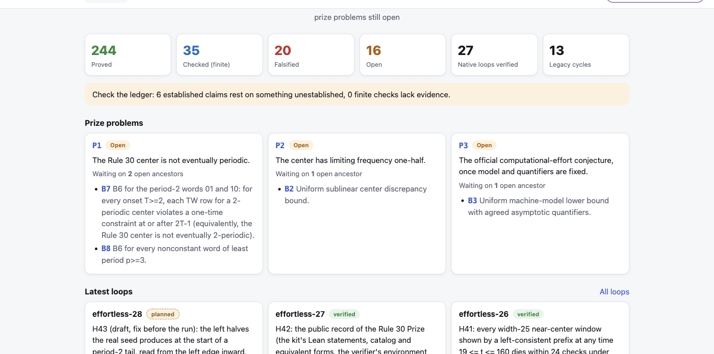
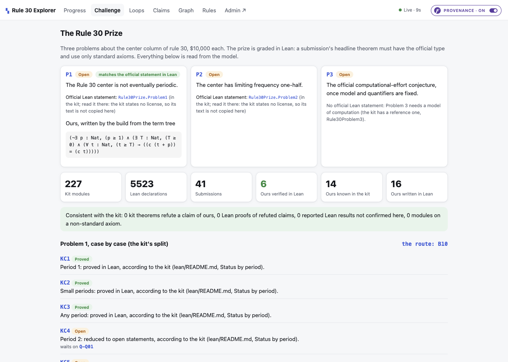
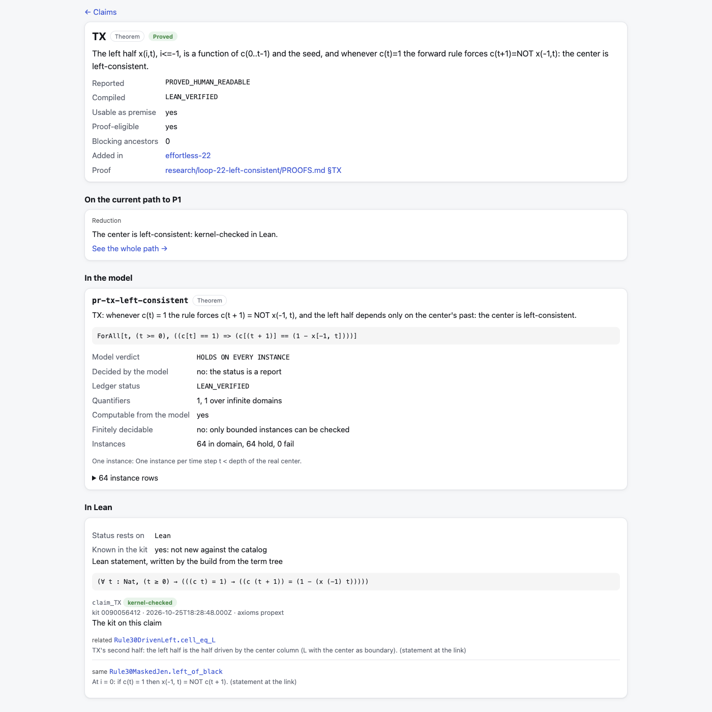
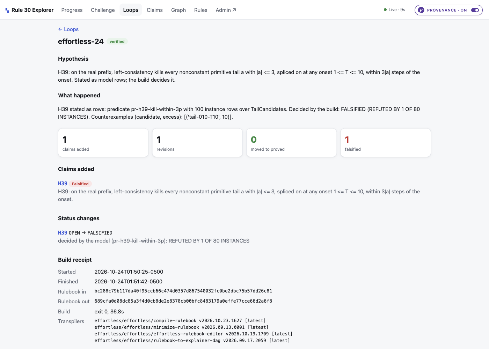
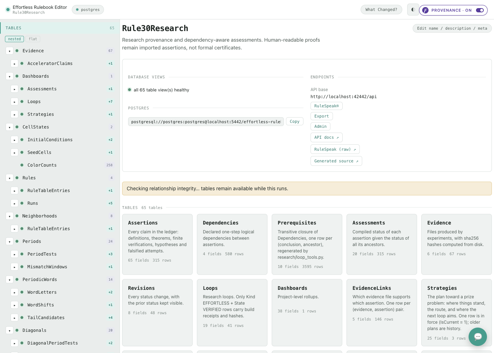

# The Rule 30 Laboratory

An open laboratory for working on the [Wolfram Rule 30 Prize](https://rule30prize.org/): three unsolved
problems about the center column of one of the simplest programs ever written, graded by a proof
assistant. Everything the attack needs is held in **one rulebook**: Rule 30 itself, cell by cell; every
research loop; every claim and the dependency graph between them; the official prize kit's Lean
statements and catalog; and every public submission. Every status on every screen is a formula over
that rulebook. When anything changes, **the build decides** again.

**No prize problem is proved here.** What this repository does is keep the whole attack in one
place where a machine, not a person, decides what is proved, what is refuted, and what is still open.


---

## Watch the walkthrough (about 11 minutes)

**The Rule 30 Laboratory**, episode 1 of the video series of the same name, walks through everything on
this page in order: what Rule 30 is, what the three problems ask, how the prize is graded, every screen
of the laboratory read aloud, how a claim gets its status, and one research loop run from its hypothesis
to the verdict the build gives back.

- Watch: **https://effortlessapi.com/watch/p1b6DwEf1HI** (this is the film's permanent address; it plays
  once the first cut is published, and this line will be updated with the YouTube link at the same time)
- Series: `24-rule-30-laboratory`, produced in the EffortlessAPI video producer. The storyboard is itself a
  rulebook (`Storyboards -> Acts -> Scenes -> Clips -> Assets`) and its `STORYBOARD.md` is the written
  form of the same tour, scene by scene, with what is on screen and what is said.
- The film is shot against this repository at commit `dd92629` (after loop 27). Every number spoken in
  it is that commit's value; the numbers below are the same ones.

Later episodes in the series each take one part of the laboratory at depth: the Rule 30 model, the Lean
ledger, the challenge sync, and a loop filmed live.

---

## Contents

1. [What Rule 30 is](#1-what-rule-30-is)
2. [The prize, and why it is graded in Lean](#2-the-prize-and-why-it-is-graded-in-lean)
3. [The problem this laboratory solves](#3-the-problem-this-laboratory-solves)
4. [Quick start](#4-quick-start)
5. [The laboratory, screen by screen](#5-the-laboratory-screen-by-screen)
6. [Under the hood: the rulebook](#6-under-the-hood-the-rulebook)
7. [How a status is decided](#7-how-a-status-is-decided)
8. [One loop, end to end](#8-one-loop-end-to-end)
9. [Where it stands](#9-where-it-stands)
10. [Repository map](#10-repository-map)
11. [Working on it](#11-working-on-it)
12. [What is and is not in this repository](#12-what-is-and-is-not-in-this-repository)
13. [Credits](#13-credits)

---

## 1. What Rule 30 is

Rule 30 is a rule for coloring cells in a row. Each cell looks at itself and its two neighbors, so there
are eight patterns it can see, and the rule says, for each one, whether the cell below is black or white.
Written as a binary number those eight answers are `00011110`, which is 30. That is the whole program.

```
pattern:   111  110  101  100  011  010  001  000
next cell:  0    0    0    1    1    1    1    0        = 30
```

Start from a single black cell on a white background and apply the rule row after row. The right side of
the triangle falls into stripes. The left side settles into diagonals with periods that double. And the
center column, straight down from the seed, looks random. Nobody has proved that it is, or that it is not.
That column is what the prize is about.

In the rulebook the automaton is data: the 8 neighborhoods (`Neighborhoods`), the rule table
(`RuleTableEntries`), the single seed (`SeedCells`), one run to depth 64 (`Runs`) and its 4,225 cells
(`Cells`), each one a formula over its three parents. Nothing about Rule 30 is computed outside the model.

## 2. The prize, and why it is graded in Lean

The [Rule 30 Prize](https://writings.stephenwolfram.com/2019/10/announcing-the-rule-30-prizes/) (Wolfram,
2019; $30,000 in total, $10,000 per problem) asks three questions about the center column:

| | Problem | Conjecture |
|---|---|---|
| **P1** | Does the center column ever become periodic? | It never does. |
| **P2** | Do black and white each occur half the time, in the limit? | They do. |
| **P3** | Can the n-th cell be computed with less than order n effort? | It cannot. |

What makes this prize different from most is how it is graded. A submission is not a paper. It is a
proof in [Lean](https://lean-lang.org/), and the headline theorem must have the official type from the
[Rule 30 Prize kit](https://github.com/WolframInstitute/Rule30PrizeKit) (`Rule30Prize.Problem1`,
`Rule30Prize.Problem2`) and use only standard axioms. A kernel checks it. The kit also holds a catalog of
partial results and over a hundred equivalent forms, all kernel-checked, and a public list of
[submissions](https://www.wolframcloud.com/obj/rule-30-prize/Agents/submissions) with the verifier's
verdict on each.

So on this challenge a claim that is not in Lean is, for grading purposes, not yet a claim. That rule
shaped the whole laboratory: the build writes our claims in Lean from their formal statements and asks
the kit's own checker whether they hold (section 7).

## 3. The problem this laboratory solves

The attack has a lot of moving parts. Rule 30 itself, cell by cell. Twenty-seven research loops of our
own work. Over three hundred claims, with a dependency graph of 580 edges between them. The prize kit,
with 227 Lean modules and 5,523 declarations. Forty-one public submissions. Keep that in notebooks and
markdown files and within a week something is stale, and a claim quietly rests on something that was
refuted.

So the laboratory keeps all of it in one rulebook, `effortless-rulebook/effortless-rulebook.json`: one
file of tables and formulas, built with the [Effortless Rulebook](https://github.com/EffortlessAPI/effortless-skills)
method. Only structure and inputs are typed in. Every status, count and flag on every screen is a formula
over that file, and the explorer that shows them computes nothing. When anything changes, the build
decides again, and nothing is written down twice.

## 4. Quick start

You need `python3`, Node 18 or newer, Docker, and the `effortless` CLI
(`npm install -g` from [effortlessapi/cli](https://github.com/effortlessapi/cli); it needs .NET 8).
Lean is optional (see below).

```bash
git clone https://github.com/eejai42/rule-30-wolfram-prize.git
cd rule-30-wolfram-prize
./start.sh
```

`start.sh` brings up two things:

| | URL | What it is |
|---|---|---|
| Explorer | http://localhost:7431 | The screens in section 5. Reads the editor's views; computes nothing. |
| Admin portal | http://localhost:42442 | The rulebook editor: every table, every row, every formula, with a Postgres behind it. |
| API | http://localhost:42441/api/docs | The generated API the explorer reads. |

The first launch builds the editor's container and loads the 25 MB rulebook into Postgres, which takes a
couple of minutes; the explorer shows "Loading" until the API answers. Hover any number in the explorer to
see the field and the formula that produced it (the `Provenance` toggle, top right).

Other commands:

```bash
./start.sh build     # rebuild the rulebook after a change (research/build.py; 6 to 9 minutes)
./start.sh sync      # sync the live prize challenge (kit, verifier, submissions), then build
./start.sh editor    # force-recreate the editor container (needed after a schema change)
```

**Lean (optional, about an hour and 8 GB the first time).** Install elan
(`curl https://elan.lean-lang.org/elan-init.sh -sSf | sh -s -- -y --default-toolchain none`), then
`./start.sh sync`. The sync clones the kit into `external/` (gitignored), fetches Mathlib, builds every
catalog module, compiles our Lean ledger against the kit and runs the kit's `Check.lean` on every theorem.
Without Lean the build still runs; its receipt says `lean: skipped` and the last Lean verdicts stay as
they are.

## 5. The laboratory, screen by screen

Every number below is a rulebook field. The field names are given so you can find them in the admin
portal or hover them in the explorer.

### 5.1 The landing page: the path to P1 (`/`)

This is the page you open every morning (first image above).

- **The challenge banner.** 227 kit modules, 41 submissions, 6 of our claims kernel-checked, 14 of our
  claims already in the kit (`Dashboards.KitModuleCount`, `SubmissionCount`, `OwnLeanVerifiedCount`,
  `OwnKnownInKitCount`). It links to the challenge page.
- **The plan in force.** The most promising path to P1 as the research currently sees it
  (`Strategies`, `StrategySteps`, written by `research/strategy.py` after every loop). On the left, the
  route: a chain of claims from the goal down to the open obligation that blocks it, each with its status.
  After loop 27 it reads **10 established, 7 open, 1 blocking the goal, 4 ruled out**. On the right: where
  the next loop aims and why, the approach, what is missing, and the odds as the plan states them (well
  under 1 percent for P1; about 1 in 30 for the period-2 case).
- **The count that matters.** 3 of 3 prize problems still open (`OpenPrizeProblemCount`).
- **The tiles.** 315 claims: **244 proved, 35 checked (finite), 20 falsified, 16 open**; 27 native loops
  verified, 13 legacy cycles. Most of the 244 proved are the kit's own Lean theorems, loaded as claims so
  our work is measured against them (217 kit claims, 212 of them `LEAN_VERIFIED`); 98 claims are ours.
- **The ledger banner.** How many established claims rest on something unestablished
  (`AtRiskCount`, 6 after loop 27: the proved-from-open edges the plan keeps on purpose, so they stay
  visible) and how many finite checks lack evidence (`EvidenceGapCount`, 0).
- **Prize problems**, each with the open ancestors it is waiting on, and the **latest loops**.



### 5.2 The challenge page (`/challenge`)

The official record, inside the laboratory.



- **The three problems**, each with the name of its official Lean statement in the kit and a link to read
  it there (the kit states no license, so its text is not copied here), and under it **ours, written by
  the build from our term tree**. For P1 the two are proved equivalent in Lean
  (`Assertions.IsOfficiallyAligned`), so when the ledger says P1 it means exactly what the prize means.
- **The counts**: kit modules, Lean declarations, submissions, ours verified in Lean, ours known in the
  kit, ours written in Lean.
- **The consistency banner.** Four counts that must stay zero (section 7).
- **Problem 1, case by case.** The kit's own split of P1 by the length of the period: period 1 proved
  (`KC1`), every period up to 4096 with a short transient proved (`KC2`), T + P >= 16359 proved (`KC3`),
  period 2 reduced to one open statement, `Q01` (`KC4`), least periods 3 and 4 reduced to open statements
  (`KC5`, `KC6`), longer periods open (`KC7`). Each case is a claim here, with the open statement it waits
  on.
- Further down: **the sources** and when each was last synced (`ChallengeSources`, `SourceSyncs`), **every
  submission** with the verifier's verdict and our own re-check beside it (`Submissions`), and **the
  catalog** of kit modules (`LeanModules`).

### 5.3 Claims, and one claim's page (`/claims`, `/claims/:id`)

Every assertion in the ledger, filtered by kind (prize problem, theorem, hypothesis, finite check, kit
result, ...) and status group. Open one. `TX` is the theorem that the center column is left-consistent:
whenever the center is black, the next center bit is forced by the cell to its left.



A claim page shows its statement, its reported and compiled status, whether it is usable as a premise,
its place on the current path, then the two sections that are the whole idea of the laboratory:

- **In the model.** The claim's formal statement as a term tree (`Predicates`, `Terms`), and its
  instances. For TX there are 64, one per time step, each decided by the build from the cells of Rule 30
  itself; all 64 hold (`Predicates.FiniteVerdict`). Whether the model can decide the claim at all
  (`IsComputable`, `IsFinitelyDecidable`) is stated plainly.
- **In Lean.** The Lean statement the build wrote from that same term tree
  (`Assertions.LeanStatement`), the kernel's verdict on it (`LeanChecks`), and the kit's declarations on
  this claim (`ClaimLinks`: same, stronger, weaker, related). TX is kernel-checked, and it is also already
  known in the kit, so it is marked that way. Nothing known is presented as new.

Below those: premises, everything that uses it, the loops that touched it, its evidence files (pinned by
sha256) and its revision history.

### 5.4 The dependency graph (`/graph`)

The same ledger drawn as a picture: every claim a node, colored by status, an edge from each premise up
to the claim that uses it, the current path to P1 outlined. Tap a node to light up everything it rests
on and everything that rests on it; double-click to open its page. The thing to notice is how status
moves along the edges: a claim whose premise is open, falsified or superseded compiles to `BLOCKED`, no
matter how good its own proof is, and that is a formula (`Prerequisites.Blocked`,
`Assessments.CurrentStatus`), not a judgment.

### 5.5 Loops (`/loops`, `/loops/:id`)

The history: 13 legacy research cycles from before this ledger existed, and 27 native loops, every one
verified. One loop is one hypothesis: stated, tested, recorded, built and consumed.



A loop page shows the hypothesis, what happened, the claims it added, the status changes it caused, and
its build receipt: the sha256 of the rulebook before the build and after it, the build's exit code and
duration, and the exact transpiler versions. That is what makes a loop auditable.

### 5.6 Files and the explainer (`/files`, `/dag`)

Proof and evidence files render in the app (`research/loop-NN/PROOFS.md`, the frontier map), and every
derived value opens into the explainer DAG: the field, its formula, and the fields it reads.

## 6. Under the hood: the rulebook

All of that is read from one file. Open the admin portal and you can see its 65 tables.



The rulebook has three halves (map: `bootstrap/rule30-model/schema.md`):

**The domain model** (owned by `research/hub/build_model.py`). Rule 30 as rows: `Rules`,
`Neighborhoods`, `RuleTableEntries`, the seed, `Runs`, `TimeSteps`, `Columns`, `Cells` (4,225). Problem 1's
objects: every (period, onset) candidate with its refuting witness (`PeriodTests`,
`PeriodicityCandidates`, 2,520), Theorem C's `MismatchWindows`, TX's `LeftConsistencyChecks`,
`PeriodicWords` with computed least periods, and B9's `TailCandidates` (the real prefix with a periodic
tail spliced on, each with its own left-half lattice and the one-time check that kills it). Problem 2's
`Tolerances` and `ColorCounts`; Problem 3's `MachineModels`, `Algorithms`, `Computations`. The diagonals
and their dyadic periods. And the predicates themselves: each formal statement is a tree of `Terms` over
`Operators` and `Variables`, with `PredicateInstances` whose domain, verdict and witness are computed.

**The ledger.** `Assertions` (315), `Dependencies` (580), their transitive closure `Prerequisites`,
`Assessments` (the compiled status of each claim given all its ancestors), `Evidence` (67 files, pinned by
sha256), `Revisions`, `Loops`, `Strategies`, and the `Dashboards` roll-up.

**The challenge** (since loop 27, loaded by `research/hub/build_challenge.py` from
`research/sources/sync.py`). `ChallengeSources` and `SourceSyncs`, the kit's `LeanModules` (265 with the
submissions' modules), `LeanDeclarations` (5,523), `LeanImports`, `LeanUses`, every `Submission` with its
headline theorems and our re-check, `ClaimLinks` (our claims read against kit declarations), `LeanProofs`
and `LeanChecks`.

Only structure and inputs are typed. Everything else is a formula, and the explainer shows you which one.
The load-bearing formulas are cached on build (`IsCached`, `*Cache` fields) because Postgres recomputes
the whole chain behind them on every read; `research/build.py` clears the caches, compiles, fills them
from that compile and builds again, so a cache always equals its fresh value.

## 7. How a status is decided

There are two ways in, and one of them is a person. A person can report a status
(`Assertions.ReportedStatus`). But where the model can decide, the model wins
(`Assertions.EffectiveStatus`):

| If | then the claim is |
|---|---|
| the model holds a counterexample instance of its predicate | `FALSIFIED`, whatever anyone reported |
| the model decides a finite statement true on every instance | `FINITE_VERIFIED` |
| the kit's `Check.lean` accepts a proof of the claim's **current** Lean statement, or (for a kit claim) the export shows its module free of non-standard axioms | `LEAN_VERIFIED` (never typed by hand) |
| otherwise | the reported status |

`DEFINITION`, `PROVED_HUMAN_READABLE`, `REDERIVED_KNOWN`, `LEAN_VERIFIED` and `FINITE_VERIFIED` are usable
premises; `OPEN`, `FALSIFIED` and `SUPERSEDED` are not, and any conclusion with such an ancestor compiles to
`BLOCKED`. On this challenge `PROVED_HUMAN_READABLE` counts as unverified until Lean says otherwise.

Five counts on the dashboard must stay zero, and the pages say so when they are not:

| Count | Meaning |
|---|---|
| `ModelContradictionCount` | a claim held proved that the model refutes |
| `KitContradictionCount` | a kit theorem refutes a claim we hold |
| `LeanContradictionCount` | Lean proves a claim the model refutes |
| `LeanUnconfirmedCount` | a reported Lean result the check here does not confirm |
| `KitUnverifiedModuleCount` | a kit module resting on a non-standard axiom |

And `UnmodeledClaimCount` is how many claims are still only words (0: every claim has a formal statement).

## 8. One loop, end to end

Loop 24 asked how fast a wrong guess dies. Take the real center column and, at some time T, splice on a
periodic tail, a short word repeated forever. Left-consistency (TX) should catch it. Hypothesis `H39`: it
always catches it within three times the length of the word.

Here is the whole loop, `research/loop-24-kill-bound/run.py`. It computes nothing:

```python
TREE = ('ForAll!', 'word', ('&&', ('&&', ('Nonconstant', a), ('==', ('LeastPeriod', a), ('Length', a))), ('<=', ('Length', a), K(3))),
        ('ForAll!', 'onset', ('&&', ('>=', T, K(1)), ('<=', T, K(10))),
         ('<=', ('KillExcess', a, T), ('*', K(3), ('Length', a)))))

def edit(book):
    keys = [r['TailCandidateId'] for r in lt.rows(book, 'TailCandidates')]
    mt.add_loop_predicate(book, PID, 'Hypothesis', 'TailCandidateExcessBound', TREE, STATEMENT,
                          'One instance per tail candidate: killed, with KillExcess <= 3|a|.', 1, 'TailCandidate', keys, slope=3, intercept=0)
    lt.add_assertion(book, 'H39', STATEMENT, deps=('TX',))
    lt.row(book, 'Assertions', 'H39')['Predicate'] = PID

consumed = lt.run_loop(LOOP, HYPOTHESIS, edit, ['H39', 'B9'], HERE, summarize=summarize)
```

It adds the hypothesis as a predicate (its statement a term tree), one instance row per tail candidate
already in the model, and the claim `H39`, `OPEN`, linked to that predicate. Then `run_loop` builds.

After the build, read the result; do not recompute it. The predicate's verdict: **refuted by 1 of 80
instances**. The word `010`, spliced on at onset 10, survives 10 steps, and the bound allowed 9. So H39's
effective status is `FALSIFIED`, the loop records that as a `Revision` (prior status, new status, reason),
and the loop is marked `VERIFIED` with its two hashes. Nobody typed "falsified". The build decided.

That is the shape of every loop since (the full procedure, including the classic form for computations
too large for rows, is in [`CLAUDE.md`](CLAUDE.md)):

1. The loop is added to `Loops` as `RUNNING` and built.
2. The hypothesis is stated as an `Assertion` (`OPEN`) with its `Dependencies`, and where possible as a
   predicate with instances.
3. The experiment runs or the proof is written; outputs under `research/loop-NN/` are registered as
   `Evidence` (path + sha256) with `EvidenceLinks`.
4. The outcome is a `Revision`; the build decides `EffectiveStatus`.
5. Build, then consume the compiled `Assessments` and `Dashboards` (read, never recompute).
6. The loop is marked `VERIFIED` with its input hash, build receipt and output hash; the plan in
   `research/strategy.py` is updated; `docs/p1-frontier.md` is updated if the chain changed.

Every loop names the open obligation it serves (`B1`, `B2`, `B3` or a child); a hypothesis with no path to
a prize problem is a side quest and its summary says so.

## 9. Where it stands

After loop 27 (2026-10-25). The rulebook is the source of truth for every status here;
[`docs/p1-frontier.md`](docs/p1-frontier.md) is the map that explains how the nodes fit.

- **No prize problem is proved.** P1, P2, P3 are `OPEN`.
- **P1, measured against the kit.** Period 1 and every eventual period with P <= 4096 and T <= 8192 are
  proved in Lean (the kit). Period 2 waits on `Q01` (the zero-boundary left half from any finite start;
  open, proved to width 52). Least periods 3 and 4 wait on open statements. Longer periods are open.
- **Our route** (`P1 <- B1, K1`; `B1 <- B9, TX`; `B9 <- B5, TU`; ... ; `B7`, `B8` open) attacks the same
  frontier from the real seed: the center is left-consistent (TX, kernel-checked), and B9 asks whether a
  left-consistent sequence can end in a periodic tail. The kit proves barriers against finite-state
  arguments over *all* finite starts (`Rule30ZeroBoundaryBarriers`), but its witnesses are never real
  left halves; that gap is the only room the route has.
- **Ruled out** (do not retry without a new idea): ten mechanisms, from bounded excess past the cone to
  any fixed-width window kill, each a falsified hypothesis or a finite check in the rulebook
  (`docs/p1-frontier.md`, "Ruled out").
- **Certified, finite.** Every nonconstant periodic center tested is excluded: periods 2 to 16, onsets to
  384, about 6,000 cases. These are not progress on P1 by themselves; a proof needs an argument uniform in
  the onset.
- **Our claims in Lean.** 16 are expressible, 6 are kernel-checked (K1, T0, TX, D0, TS, T004), and our P1
  is proved equivalent to the official `Problem1`. 14 of ours are already in the kit; none is new against
  the catalog.
- **Next loop (28, planned).** Whether the real left halves at the start of a period-2 tail, read from the
  left edge inward, fit a finite automaton whose size stops growing through t = 160.
- **The odds, as the plan states them.** P1: well under 1 percent. The period-2 case: about 1 in 30.

## 10. Repository map

```
effortless-rulebook/
  effortless-rulebook.json           the Single Source of Truth (about 25 MB compiled)
  *.derived-read-me-1st.txt          start here when querying it; then *.derived-schema.min.json
  edit-rulebook.sh, docker/          the generated rulebook editor (admin portal + API + Postgres)
explorer/                            the Vite + React explorer on port 7431 (reads views; computes nothing)
research/
  build.py                           THE build: caches cleared, effortless build, caches filled, build again
  loop_tools.py, model_tools.py      the only way to edit the hub; run_loop(), add_loop_predicate()
  strategy.py                        the plan in force (Strategies, StrategySteps)
  hub/build_model.py                 owns the domain model tables; check_model.py, check_postgres.py check them
  hub/formal_claims.py               term trees for claims not decided by instances
  hub/build_challenge.py             loads the kit, the verifier, the submissions into the model
  sources/sync.py, licenses.py       sync the live challenge; what each license lets us keep
  lean/ledger.py, proofs.py          write lean/Rule30Ledger.lean from the term trees; our proofs; Check.lean verdicts
  loop-00-setup ... loop-27-challenge   one folder per loop: run.py, PROOFS.md, evidence
  ingest/                            the analysis database (bulk data outside the rulebook)
lean/                                the generated Lean ledger (never edited by hand)
postgres/                            rulebook-to-postgres output: tables, vw_* views, witness rows
docs/
  p1-frontier.md                     the map of the attack on P1
  app.md                             the explorer's personas, stories and routes
  toolchain-gaps.md                  every toolchain gap hit, and its fix
bootstrap/                           the handoff this ledger started from; rule30-model/ is the model's oracle
NOTICE.md                            every external source, its license, and what is kept here (generated)
CLAUDE.md                            the working rules: how to edit, build, loop, and what must stay zero
start.sh                             explorer + editor; build; sync
```

## 11. Working on it

The rules that keep the laboratory consistent are in [`CLAUDE.md`](CLAUDE.md). The short form:

- **The rulebook is the Single Source of Truth.** Everything derived is regenerated by the build. Query it;
  never read the 25 MB file whole.
- **Edit the hub with `research/loop_tools.py`**, never by hand. It keeps the `Prerequisites` closure
  consistent with `Dependencies`.
- **Always build with `python3 research/build.py`** (or `./start.sh build`), never a bare
  `effortless build`: the load-bearing fields are cached and a bare build would compile with stale caches.
- **Never reimplement the status logic** in a script. Read the compiled values.
- **A claim about Rule 30 belongs in the model** as rows and formulas the build decides. Python may only
  accelerate, and its values enter as `AcceleratorClaims` the model checks.
- **Before claiming anything new**, read `Assertions.IsKnownInKit` and the submissions list: a claim the
  kit proves is not new, and more instances of an existing method are not worth a submission.
- **Builds refuse stale evidence.** A registered file that differs from its sha256 stops the build;
  `--refresh-evidence` is for deliberate revisions.

To run your first loop, read `docs/p1-frontier.md`, pick an open obligation, copy
`research/loop-24-kill-bound/run.py`, state your hypothesis as a term tree over the model, and run it.
If the hypothesis needs a concept the model lacks, add it to `research/hub/build_model.py` first (checked
by `check_model.py` against the oracle in `bootstrap/rule30-model/mock-data/`, and by `check_postgres.py`
against the editor's views), then `./start.sh editor` to recreate the editor with the new schema.

## 12. What is and is not in this repository

Licenses decide what is kept here ([`NOTICE.md`](NOTICE.md), generated by `research/sources/licenses.py`).
The prize kit, the submissions and the prize's agent instructions state no license, so **no Lean source,
statement, docstring, abstract or instruction text of theirs is committed**: `./start.sh sync` downloads
them into `external/` (gitignored) for whoever runs the checks, and the snapshots in
`research/sources/snapshots/` keep references and results only (names, links, versions, hashes, what the
checks said). The explorer's challenge page follows the same rule: it names the official declaration and
links to it.

This repository's own files (the rulebook, the research, the explorer) carry no license file yet.

## 13. Credits

- The Rule 30 Prize: Stephen Wolfram and the Wolfram Foundation ([rule30prize.org](https://rule30prize.org/)).
- The Rule 30 Prize kit, its catalog of partial results, equivalent forms and barriers: the Wolfram
  Institute and the contributors named in its `lean/README.md`
  ([WolframInstitute/Rule30PrizeKit](https://github.com/WolframInstitute/Rule30PrizeKit)).
- Lean 4 (the Lean FRO) and Mathlib (the Mathlib community), Apache-2.0.
- The Effortless Rulebook method, CLI and skills: [EffortlessAPI](https://effortlessapi.com).
- The partial results this ledger started from:
  `bootstrap/cmcc_rule30_effortless_migration/research_v05/REPORT.md`.
